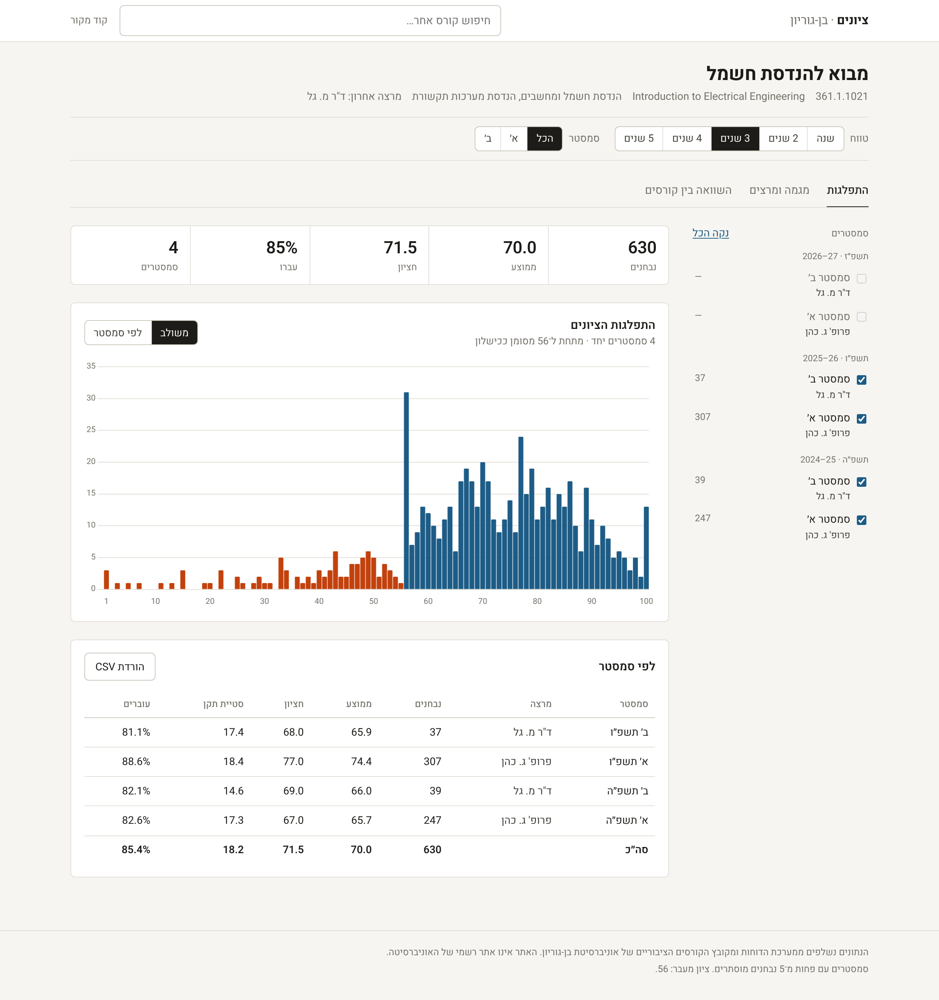
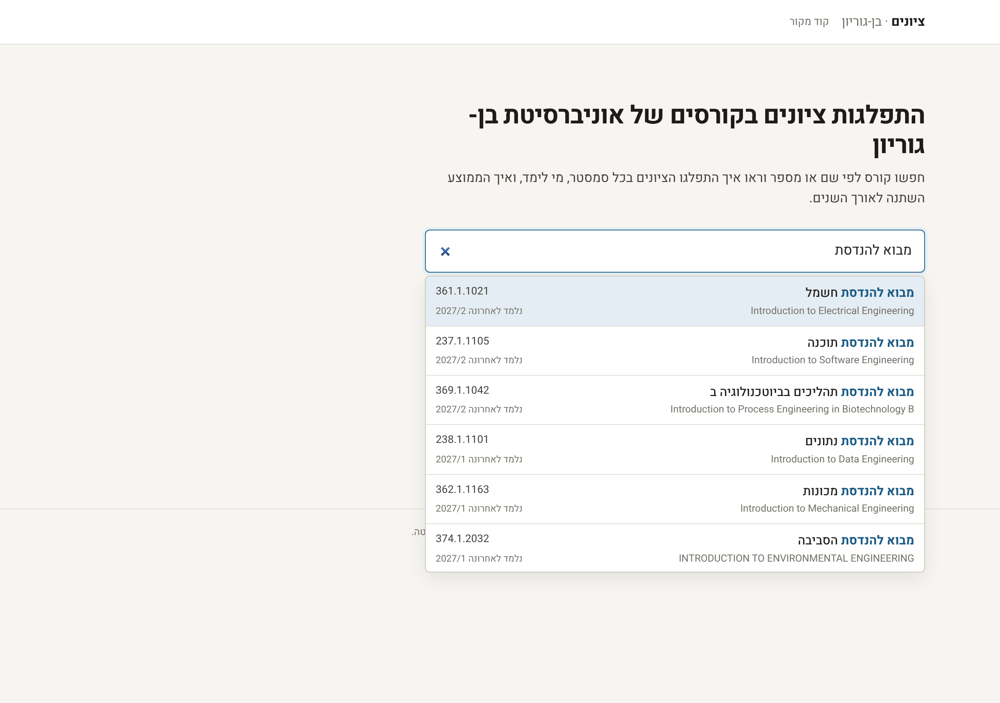
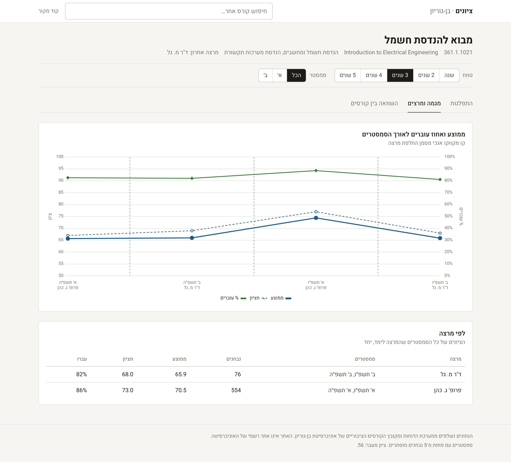
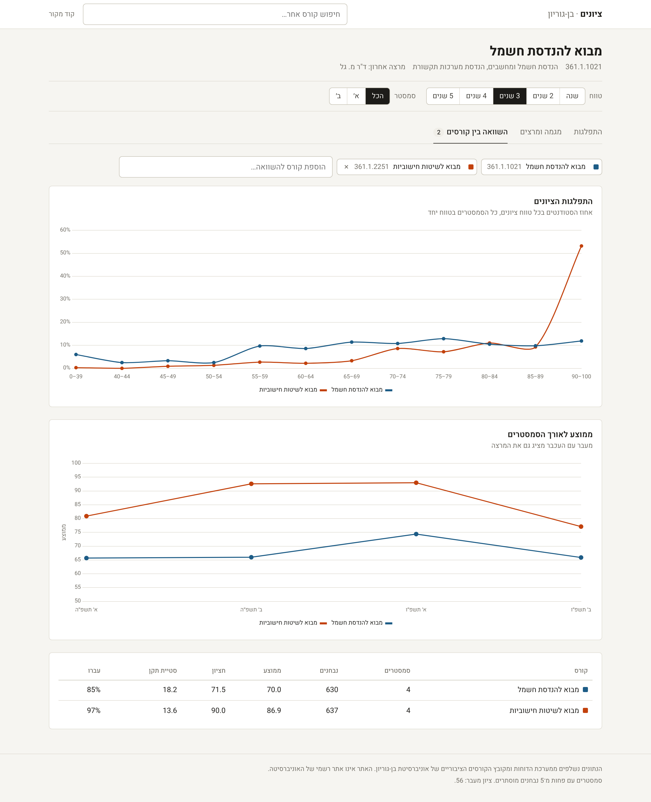
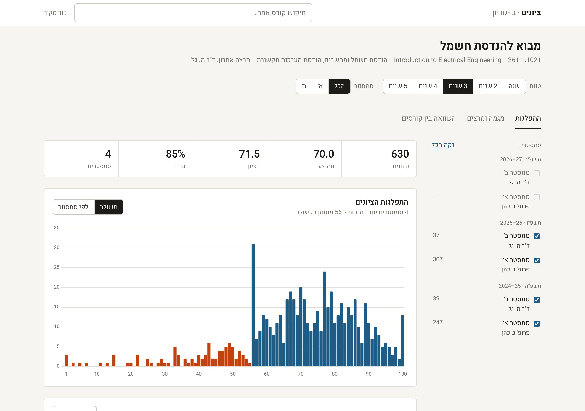
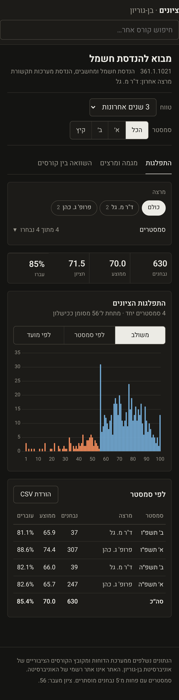

<div dir="rtl">

# ציונים · בן-גוריון

**התפלגות ציונים, מרצים ומגמות לאורך השנים בקורסים של אוניברסיטת בן-גוריון בנגב.**

חפשו קורס לפי שם או מספר וראו איך התפלגו הציונים בכל סמסטר, מי לימד בכל סמסטר, איך הממוצע השתנה לאורך השנים, והשוו בין כמה קורסים על אותו גרף.

**דמו: [bgu-grades-2.vercel.app](https://bgu-grades-2.vercel.app)**



## מה אפשר לעשות

| | |
|---|---|
| **חיפוש לפי שם קורס** | מקלידים חלק משם הקורס ומקבלים רשימה של קורסים עם המספר, השם באנגלית ומתי נלמד לאחרונה. אפשר גם להקליד מספר (`361.1.1021`). |
| **התפלגות ציונים** | כל הציונים מ־1 עד 100, בכל הסמסטרים יחד או בכל סמסטר בנפרד, עם ממוצע, חציון, סטיית תקן ואחוז עוברים. כולל סמסטר קיץ, ועד 8 שנים אחורה. אפשר לבחור אילו סמסטרים ייכללו. |
| **לפי מועד** | התפלגות וממוצע בנפרד למועד א׳, מועד ב׳ ומועד מיוחד. אפשר לראות את כל הסמסטרים יחד, או קו לכל מועד בכל סמסטר על אותו גרף (צבע = מועד, סוג קו = סמסטר). |
| **סיור מודרך** | סיור של 12 צעדים שמסמן כל חלק בעמוד ומסביר אותו. מופעל מהכפתור "סיור מודרך" בעמוד הבית או בעמוד הקורס, ומוצע פעם אחת למבקרים חדשים. |
| **עמוד הסבר** | `/guide` מסביר מה מוצג בכל לשונית, את המושגים, ומאיפה הנתונים. |
| **מרצים לפי סמסטר** | ליד כל סמסטר מופיע מי לימד את השיעור באותו סמסטר, ואפשר לסנן את ההתפלגות לפי מרצה. |
| **מגמה ומרצים** | גרף של הממוצע, החציון ואחוז העוברים לאורך הסמסטרים, עם סימון של החלפת מרצה, וטבלה שמסכמת את הציונים לפי מרצה. |
| **השוואה בין קורסים** | עד ארבעה קורסים על אותו גרף: התפלגות באחוזים (כדי שקורסים בגדלים שונים יהיו ברי השוואה) וממוצע לאורך הזמן. |
| **שיתוף** | כל מצב נשמר בכתובת, כך שאפשר לשלוח קישור לקורס, לטאב או להשוואה. |

<table>
<tr>
<td width="50%"><br><sub>חיפוש לפי שם קורס</sub></td>
<td width="50%"><br><sub>מגמה לאורך הסמסטרים ולפי מרצה</sub></td>
</tr>
<tr>
<td width="50%"><br><sub>השוואה בין קורסים</sub></td>
<td width="50%"><br><sub>טעינה עם התקדמות לפי סמסטר</sub></td>
</tr>
</table>

<p align="center"><br><sub>מובייל, מצב כהה</sub></p>

## הרצה מקומית

צריך Node.js 20 ומעלה.

```bash
git clone https://github.com/omer12091234/bgu-grades.git
cd bgu-grades
npm install
npm run dev
```

ואז לפתוח את http://localhost:3000. לא צריך משתני סביבה או מפתחות.

פקודות נוספות:

```bash
npm run build   # בנייה לפרודקשן
npm run start   # הרצת הבנייה
npm run lint    # בדיקת קוד
```

## פריסה ל־Vercel

הריפו מחובר ל־Vercel: כל דחיפה ל־`main` מתפרסמת אוטומטית, וכל ענף אחר מקבל כתובת preview. כדי לפרוס עותק משלכם: **New Project** ב־Vercel ← בחירת הריפו ← **Deploy**. לא צריך הגדרות.

## מאיפה הנתונים

| מקור | מה לוקחים משם |
|---|---|
| מערכת הדוחות (`reports4u22.bgu.ac.il`, דוח `SCRR016w`) | הציונים של כל סטודנט בקורס בסמסטר, בלי פרטים מזהים. הפרמטר `grade` בוחר את הקבוצה: 5 = ציון סופי של כל הנבחנים, 1 = מועד א׳, 2 = מועד ב׳, 3 = מועד מיוחד (לדוח אין שם לקבוצה הזאת) |
| קובץ הקורסים (`bgu4u.bgu.ac.il`, שנתון) | חיפוש קורס לפי שם, ושמות המרצים בכל סמסטר |

קורסים שעברו ממחלקה 201 ל־212 בתשפ״ו שמרו על מספרם, ולכן הציונים של שנים קודמות נשלפים אוטומטית מהמספר הישן (למשל 212.1.2361 ← 201.1.2361).

שני המקורות ציבוריים ולא דורשים התחברות. השרתים שלהם ישנים ואיטיים ומחזירים קידוד Windows-1255, ולכן כל הגישה אליהם עוברת דרך השרת של האתר.

### מטמון (cache)

ציונים של סמסטר שהסתיים כמעט לא משתנים, אז אין סיבה לפנות לאוניברסיטה בכל צפייה:

| מידע | נשמר ל־ | איפה |
|---|---|---|
| ציונים של שנה שהסתיימה | 30 יום | Data Cache של Next.js + CDN של Vercel |
| ציונים של השנה הנוכחית | 6 שעות | אותו דבר |
| מרצים של סמסטר שעבר | 180 יום | Data Cache |
| מרצים בשנה הנוכחית | שבוע | Data Cache |
| תוצאות חיפוש לפי שם | יום | Data Cache + CDN |

הדפדפן טוען סמסטר אחד בכל בקשה (`/api/term`), כך שכל סמסטר נשמר בנפרד ב־CDN, והמסך מציג התקדמות בזמן הטעינה. שגיאות לא נשמרות במטמון.

## מבנה הקוד

| קובץ | תפקיד |
|---|---|
| `app/page.tsx` | הממשק: חיפוש, טאבים, סרגל סמסטרים, השוואה |
| `app/api/term/route.ts` | ציונים ומרצים של סמסטר אחד בקורס |
| `app/api/courses/route.ts` | חיפוש קורסים לפי שם |
| `lib/fetcher.ts` | פנייה למערכת הדוחות ושמירה במטמון |
| `lib/catalog.ts` | חיפוש בקובץ הקורסים וחילוץ שמות המרצים |
| `lib/parser.ts` | פענוח ה־XML של הדוח |
| `lib/stats.ts` | ממוצע, חציון, התפלגות, סיכום לפי מרצה |
| `lib/useCourseSeries.ts` | טעינת הסמסטרים בדפדפן, שתי בקשות במקביל |
| `components/` | גרפים (Chart.js), חיפוש, טבלאות ומסך טעינה |

## פרטיות

- הדוח נשלף תמיד במצב ציבורי (`P_FOR_STUDENT` לא נשלח). הלקוח לא יכול לשנות את זה.
- סמסטרים עם פחות מ־5 נבחנים מוסתרים.
- תוכן התשובות מהאוניברסיטה לא נכתב ללוגים.
- האתר אינו אתר רשמי של אוניברסיטת בן-גוריון.

</div>
